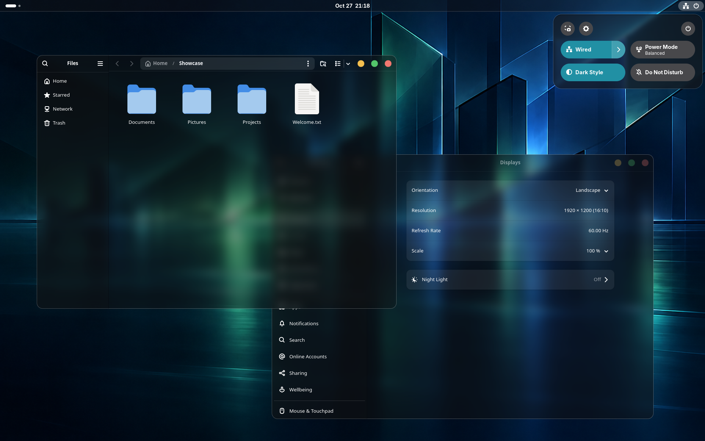
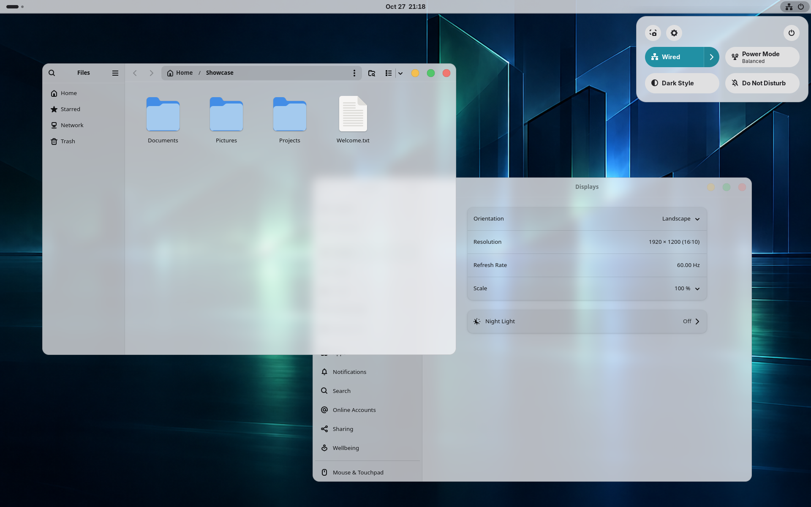
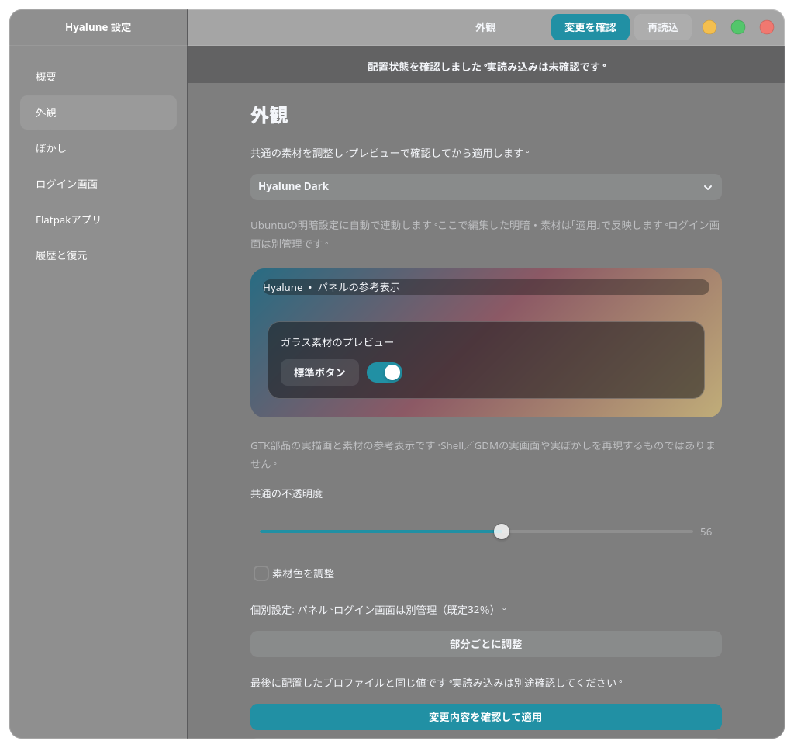

# Hyalune

**Hyalune Dark**



Darkを基本とした表示例です。共通面56％・パネル38％の既定素材に任意ぼかしを加え、背景の光を通しながら文字とアイコンを鮮明に保ちます。

**Hyalune Light**



Lightは共通面78％・パネル74％の既定素材です。同じアプリを開いたままUbuntuの明暗設定で切り替えています。

両画像はUbuntu 26.04／GNOME Shell 50.1／Waylandで、実際の「ファイル」「設定」とQuick Settingsを撮影しました。アクセントはGNOME設定の青緑（teal）。背景は紹介用に生成した「Midnight Harbor — 深夜の湾岸都市」です。

## 概要

Hyaluneは、ガラスのような透明感と読みやすさを両立するデスクトップテーマです。このソースには**Hyalune Dark**と[**Hyalune Light**](docs/LIGHT.md)を実装しています。細い境界線、柔らかな影、丸いウィンドウ操作ボタンで外観を整え、ウィンドウが重なっても文字やアイコンの鮮明さを保つよう配慮しています。

GNOME標準の配置・操作を生かし、GNOME Shell、GTK3、GTK4 / libadwaitaの色と質感をそろえます。背景ぼかしは独自拡張による任意機能です。

最新版は[**v0.3.2**](https://github.com/NBE03xxx/hyalune-theme/releases/tag/v0.3.2)です。Dark／LightとUbuntu明暗設定への自動連動に対応しています。「Hyalune 設定」から共通の外観・対象別の調整・対応Flatpakを管理できます。通常のデスクトップ向けインストーラーは機種名に依存せず、OS・GNOME・Waylandなどの導入条件を確認します。

## 対象

| 対象 | 適用範囲 |
| --- | --- |
| GNOME Shell | トップバー、Quick Settings、通知、カレンダー、Overview、OSD、ログアウト・電源オフの確認など |
| GTK3アプリ | タイトルバー、ボタン、タブ、サイドバーなど。本文の独自描画はアプリに依存 |
| GTK4 / libadwaitaアプリ | ウィンドウ操作ボタン、タイトル面、標準的な内容面など。アプリの構造・配色によって差あり |
| Flatpakアプリ | 対応GTK系へアプリ単位で適用。[後述](#flatpak) |
| Chromeなど独自UIのアプリ | 丸ボタンなどGTKを参照する一部。タイトルバーや本文の統一・透明化は対象外 |
| Snap / AppImage | アプリ内テーマの対象外 |

認証・権限確認などの共通ダイアログや、スクリーンショット操作部などの補助UIはGNOME標準の外観を維持します。すべてのアプリを同じ外観にすることは目指しません。ウィンドウ全体の透明度を下げず、文字・アイコンの読みやすさを優先します。

## Install / Uninstall

### OS、必須拡張機能その他条件

- 導入対象：Ubuntu 26.04、GNOME Shell 50.x、Wayland。動作確認はShell 50.1。
- 他のOSでの動作は未確認です。
- **User Themes**（UUID：`user-theme@gnome-shell-extensions.gcampax.github.com`）を導入・有効化済みであること。
- `git`、`python3`、PyGObject / Gio（`python3-gi`）、`glib-compile-schemas`が利用できること。Flatpak対応を使う場合は`flatpak`も必要です。
- 通常テーマは通常ユーザーで実行してください。任意GDMの管理のみ`sudo`を使います。依存パッケージは自動導入しません。固定Darkの導入に`deb`化・`sassc`は不要です。管理アプリと自動明暗連動には追加の依存があります。
- 任意ぼかしの確認範囲は単一画面・100％表示です。High ContrastやReduced Motionでは効果を停止します。GTK3の自動追従には制約があります。[詳しい条件](docs/INSTALL.md)

### Install

公開リポジトリから取得して実行します。公開ソースの取得にGitHubアカウントやSSH鍵は不要です。

```sh
git clone https://github.com/NBE03xxx/hyalune-theme.git
cd hyalune-theme
./install.sh
./install.sh plan --blur off
./install.sh apply --blur off
./install.sh status
```

機種固有の引数は不要です。`plan`で変更対象を確認してから適用してください。既存のGTK設定・リンク・拡張設定は復元用に保全します。[導入条件・更新・復旧](docs/INSTALL.md)

初回導入はShell・GTK・独自拡張を一括配置し、既存の対応GTK系Flatpakにも自動適用します。ぼかしなしの外観を確認した後、[Hyalune 設定](#hyalune-設定管理アプリ)から任意ぼかしを有効にできます。プロファイルの明暗別素材を使う場合、更新も管理アプリから行います。

拡張コードの初回読み込みや更新には、Waylandでのログアウト→ログインが必要な場合があります。GTKアプリは完全終了して開き直してください。スクリプトは自動ログアウトしません。

### Uninstall

次のどちらかを実行します。管理中のFlatpakアプリを自動scanし、そのCSS・権限設定と基本テーマを一括して復元します。アプリIDや機種固有の指定は不要です。

```sh
# Hyaluneのぼかし設定2項目を残して解除
./install.sh remove --settings keep

# Hyaluneのぼかし設定2項目も導入前へ戻して解除（既定）
./install.sh remove --settings discard
```

起動中の対象アプリや設定の競合があれば、変更前に対象と理由を表示して停止します。対象アプリを閉じるなどの対応後、同じコマンドを再実行してください。アプリは自動終了しません。

どちらも元のテーマ・GTK設定・拡張の状態へ復元します。`keep`で残すのはHyaluneの効果設定だけで、見た目の適用は解除します。`discard`でも導入前から存在する設定や、利用者が後で変更した設定を無条件には消しません。安全な復元のため、バックアップと処理記録は両方とも保持します。[設定の範囲と復旧](docs/INSTALL.md#解除と設定の扱い)

### Hyalune 設定（管理アプリ）

通常ユーザーでアプリ本体・起動入口・アイコンを導入します。GTK4、libadwaita、PyGObjectと`sassc`が必要です。依存パッケージを自動導入しません。

```sh
./install.sh manager install  # 初回・更新
./install.sh manager status
```

初回は「Hyalune 設定」で配置済みの素材とぼかし選択を確認し、一度適用してから再ログインします。このソースのテーマ・有効な拡張・管理アプリがそろうと、Ubuntu「設定 → 外観」からDark／Lightが自動で切り替わります。管理アプリのウィンドウを開いておく必要はありません。GDMは連動対象外です。[自動連動の条件](docs/LIGHT.md)

アプリ一覧や検索から「Hyalune 設定」を開きます。共通の外観とプレビューを中心に表示し、個別調整は対象を選んだときだけ開きます。対応Flatpakの共通追従・個別値・現在値の保持を選択できます。保存と適用は別操作です。

<p align="center">
  <a href="docs/images/hyalune-settings.png">
    
  </a>
</p>

表示言語はユーザーの言語環境に従い、日本語環境では日本語、それ以外では英語になります。言語設定を変更した場合はアプリを開き直してください。

アプリだけの解除は`./install.sh manager remove`です。テーマ・プロファイル・バックアップは保持します。GDMのGUI操作には管理者が専用窓口を別途導入し、OS標準の認証画面を使います。[導入・GDM認証・確認範囲](docs/THEME-MANAGER.md)

### Flatpak

Hyalune初回導入時に、インストール済みのFlatpakアプリを検出します。GTKの使用を確認できた停止中のアプリへ自動適用し、起動中・競合・未判定・未対応は理由を表示して保留または除外します。全Flathubアプリの対応を意味しません。

後から追加したアプリは「Hyalune 設定」で再検出・選択し、共通追従・個別設定・現在の適用を保持から選びます。固定Darkを単独CLIで導入する場合は、アプリを閉じて次を実行します。

```sh
./install.sh flatpak scan
./install.sh flatpak plan --app APP_ID
./install.sh flatpak apply --app APP_ID
```

適用後はアプリを開き直します。Qt系は未対応です。詳細は[Flatpakへの適用・更新・解除](docs/FLATPAK.md)を参照してください。[Hyalune 設定](docs/THEME-MANAGER.md)にも、再検出・選択適用を実装しています。

### GDM（任意）

ログイン画面のテーマは通常のデスクトップとは別に適用します。GDMはUbuntu 26.04／GNOME Shell 50.xと対応する標準GDM資源を対象とし、機種名で制限しません。利用者が自身の環境で表示・通常ログインと復旧手順を確認して使う任意機能です。

```sh
sudo ./install.sh gdm plan
sudo ./install.sh gdm set
sudo ./install.sh gdm status
```

初回・更新とも同じコマンドです。初回は現在のデスクトップ壁紙を取り込み、更新では保存した背景を維持します。壁紙の取り込み直しは`sudo ./install.sh gdm background`、解除は`sudo ./install.sh gdm remove`です。[保全・復旧と確認範囲](docs/GDM.md)

## 詳細

SCSS、Shell効果、導入・復元処理、ビルド方法は[構成とコードの説明](docs/ARCHITECTURE.md)を参照してください。

## 参考

開発時に外観や描画方式を検討するうえで参考にした資料です。各テーマのコード・画像・アセットは取り込んでいません。

- [MacTahoe GTK Theme](https://github.com/vinceliuice/MacTahoe-gtk-theme)
- [WhiteSur GTK Theme](https://github.com/vinceliuice/WhiteSur-gtk-theme)
- [liquid-glass](https://github.com/ryohsuke1231/liquid-glass)
- [GNOME Shell 50.1](https://github.com/GNOME/gnome-shell/tree/50.1) / [Shell 50移行ガイド](https://gjs.guide/extensions/upgrading/gnome-shell-50.html)
- [GTK CSS](https://docs.gtk.org/gtk4/css-overview.html) / [libadwaitaの外観仕様](https://gnome.pages.gitlab.gnome.org/libadwaita/doc/1.9/styles-and-appearance.html)

## ライセンス

本プロジェクトで新規作成したコード・スタイル・文書は[MIT License](LICENSE)です。管理アプリアイコンはGNOME Tweaksの色変更版で、CC BY-SA 4.0です。GNOME、GTK、libadwaita、User Themesなどの依存資源は、それぞれのライセンスに従います。[同梱物と依存資源](docs/LICENSES.md)
