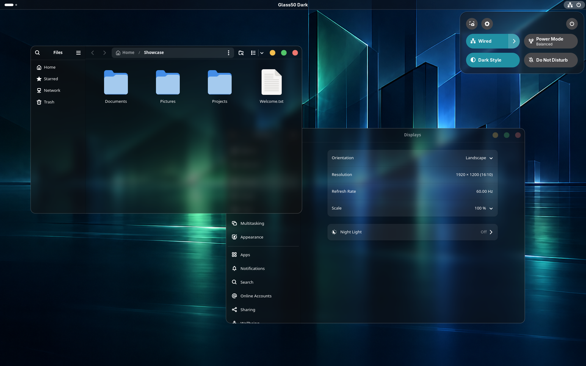

# Hyalune



Ubuntu 26.04 / GNOME Shell 50.1 / Waylandでの表示例。専用の空の環境で「ファイル」「設定」を起動し、Quick Settingsを開いています。表示例のアクセントは青緑（teal）です。Quick Settingsの選択色はGNOMEのアクセント設定に追従します。背景の題材は「Midnight Harbor — 深夜の湾岸都市」。静かな海とガラス建築、海面に映る緑・青の光を幾何学的に抽象化した、紹介用の生成画像です。

## 概要

Hyaluneは、ガラスのような透明感と読みやすさを両立するデスクトップテーマです。現在は**Hyalune Dark**を提供し、Lightは今後追加する予定です。細い境界線、柔らかな影、丸いウィンドウ操作ボタンで外観を整え、ウィンドウが重なっても文字やアイコンの鮮明さを保つよう配慮しています。

GNOME標準の配置・操作を生かし、GNOME Shell、GTK3、GTK4 / libadwaitaの色と質感をそろえます。背景ぼかしは独自拡張による任意機能です。MacTahoeやWhiteSurの導入を必要としません。

現在のリリースは**v0.1.0**です。通常のデスクトップ向けインストーラーは機種名に依存せず、OS・GNOME・Waylandなどの導入条件を確認します。新しい共通入口の導入・更新・解除・復旧は、VMの専用環境で検証しています。

旧称はGlass50 Dark / MyGlassです。文書上の名称をHyaluneへ統一しました。既存の導入・復元との互換性を保つため、テーマの配置名・拡張UUID・設定の保存先などには従来の識別名が残っています。[内部識別名について](docs/ARCHITECTURE.md#名称と内部識別名)

## 対象

| 対象 | 適用範囲 |
| --- | --- |
| GNOME Shell | トップバー、Quick Settings、通知、カレンダー、Overview、OSDなど |
| GTK3アプリ | タイトルバー、ボタン、タブ、サイドバーなど。本文の独自描画はアプリに依存 |
| GTK4 / libadwaitaアプリ | ウィンドウ操作ボタン、タイトル面、標準的な内容面など。アプリの構造・配色によって差あり |
| Flatpakアプリ | 対応GTK系へアプリ単位で適用。[後述](#flatpak) |
| Chromeなど独自UIのアプリ | 丸ボタンなどGTKを参照する一部。タイトルバーや本文の統一・透明化は対象外 |
| Snap / AppImage | アプリ内テーマの対象外 |

すべてのアプリを同じ外観にすることは目指しません。ウィンドウ全体の透明度を下げず、文字・アイコンの読みやすさを優先します。

## Install / Uninstall

### OS、必須拡張機能その他条件

- 導入対象：Ubuntu 26.04、GNOME Shell 50.x、Wayland、Dark。動作確認はShell 50.1。
- 他のOSでの動作は未確認です。
- **User Themes**（UUID：`user-theme@gnome-shell-extensions.gcampax.github.com`）を導入・有効化済みであること。
- `git`、`python3`、PyGObject / Gio（`python3-gi`）、`glib-compile-schemas`が利用できること。Flatpak対応を使う場合は`flatpak`も必要です。
- 通常テーマは通常ユーザーで実行してください。任意GDMの管理のみ`sudo`を使います。依存パッケージは自動導入しません。通常の導入に`deb`化・`sassc`は不要です。
- 任意ぼかしの確認範囲は単一画面・100％表示です。High ContrastやReduced Motionでは効果を停止します。GTK3の自動追従には制約があります。[詳しい条件](docs/INSTALL.md)

### Install

公開リポジトリから取得して実行します。公開ソースの取得にGitHubアカウントやSSH鍵は不要です。

```sh
git clone https://github.com/NBE03xxx/hyalune-theme.git
cd hyalune-theme
./install.sh
./install.sh plan --blur off
./install.sh apply --blur off
./install.sh status
```

機種固有の引数は不要です。`plan`で変更対象を確認してから適用してください。既存のGTK設定・リンク・拡張設定は復元用に保全します。[導入条件・更新・復旧](docs/INSTALL.md)

初回導入はShell・GTK・独自拡張を一括配置し、既存の対応GTK系Flatpakにも自動適用します。ぼかしなしの外観を確認した後、任意で有効化します。

```sh
./install.sh update --blur on
```

拡張コードの初回読み込みや更新には、Waylandでのログアウト→ログインが必要な場合があります。GTKアプリは完全終了して開き直してください。スクリプトは自動ログアウトしません。

### Uninstall

次のどちらかを実行します。管理中のFlatpakアプリを自動scanし、そのCSS・権限設定と基本テーマを一括して復元します。アプリIDや機種固有の指定は不要です。

```sh
# Hyaluneのぼかし設定2項目を残して解除
./install.sh remove --settings keep

# Hyaluneのぼかし設定2項目も導入前へ戻して解除（既定）
./install.sh remove --settings discard
```

起動中の対象アプリや設定の競合があれば、変更前に対象と理由を表示して停止します。対象アプリを閉じるなどの対応後、同じコマンドを再実行してください。アプリは自動終了しません。

どちらも元のテーマ・GTK設定・拡張の状態へ復元します。`keep`で残すのはHyaluneの効果設定だけで、見た目の適用は解除します。`discard`でも導入前から存在する設定や、利用者が後で変更した設定を無条件には消しません。安全な復元のため、バックアップと処理記録は両方とも保持します。[設定の範囲と復旧](docs/INSTALL.md#解除と設定の扱い)

### Flatpak

Hyalune初回導入時に、インストール済みのFlatpakアプリを検出します。GTKの使用を確認できた停止中のアプリへ自動適用し、起動中・競合・未判定・未対応は理由を表示して保留または除外します。全Flathubアプリの対応を意味しません。

テーマ導入後に追加したアプリは、閉じた状態で次を実行します。

```sh
./install.sh flatpak scan
./install.sh flatpak plan --app APP_ID
./install.sh flatpak apply --app APP_ID
```

適用後はアプリを開き直します。Qt系は未対応です。詳細は[Flatpakへの適用・更新・解除](docs/FLATPAK.md)を参照してください。後追加アプリの検出・選択適用は、将来の管理アプリにも設ける予定です。

### GDM（任意）

ログイン画面のテーマは通常のデスクトップとは別に適用します。現在の確認対象はKVMとThinkPad T16 Gen 4（Ubuntu 26.04 / Shell 50.x）です。他の実機では停止します。

```sh
sudo ./install.sh gdm plan
sudo ./install.sh gdm set
sudo ./install.sh gdm status
```

初回・更新とも同じコマンドです。初回は現在のデスクトップ壁紙を取り込み、更新では保存した背景を維持します。壁紙の取り込み直しは`sudo ./install.sh gdm background`、解除は`sudo ./install.sh gdm remove`です。[保全・復旧と確認範囲](docs/GDM.md)

## 詳細

SCSS、Shell効果、導入・復元処理、ビルド方法は[構成とコードの説明](docs/ARCHITECTURE.md)を参照してください。

## 参考

開発時に外観や描画方式を検討するうえで参考にした資料です。各テーマのコード・画像・アセットは取り込んでいません。

- [MacTahoe GTK Theme](https://github.com/vinceliuice/MacTahoe-gtk-theme)
- [WhiteSur GTK Theme](https://github.com/vinceliuice/WhiteSur-gtk-theme)
- [liquid-glass](https://github.com/ryohsuke1231/liquid-glass)
- [GNOME Shell 50.1](https://github.com/GNOME/gnome-shell/tree/50.1) / [Shell 50移行ガイド](https://gjs.guide/extensions/upgrading/gnome-shell-50.html)
- [GTK CSS](https://docs.gtk.org/gtk4/css-overview.html) / [libadwaitaの外観仕様](https://gnome.pages.gitlab.gnome.org/libadwaita/doc/1.9/styles-and-appearance.html)

## ロードマップ

機種固有の指定を不要にした共通の導入・更新・解除・復旧を整備しました。今後も確認する構成と運用条件を広げます。

- **GDM**：ログイン画面への任意適用を実装。通常テーマと分離した保全・復元を使用します。KVM／T16を対象とし、他の実機は未確認です。[操作手順](docs/GDM.md)
- **管理アプリ**：Shell、GTK、拡張機能、GDM、Flatpakの不透明度・色合いを連動して変更し、後から追加したFlatpakも選択適用できるようにする予定です。
- **Hyalune Light**：明るい外観の追加。現在はDarkのみです。将来はGNOMEの設定画面からのDark / Light切り替えを第一候補とし、難しい場合は管理アプリでの切り替えを検討します。

詳細と現在の制約は[ロードマップ](docs/ROADMAP.md)を参照してください。

## ライセンス

本プロジェクトで新規作成したコード・スタイル・文書は[MIT License](LICENSE)です。GNOME、GTK、libadwaita、User Themesなどの依存資源は、それぞれのライセンスに従います。[同梱物と依存資源](docs/LICENSES.md)
