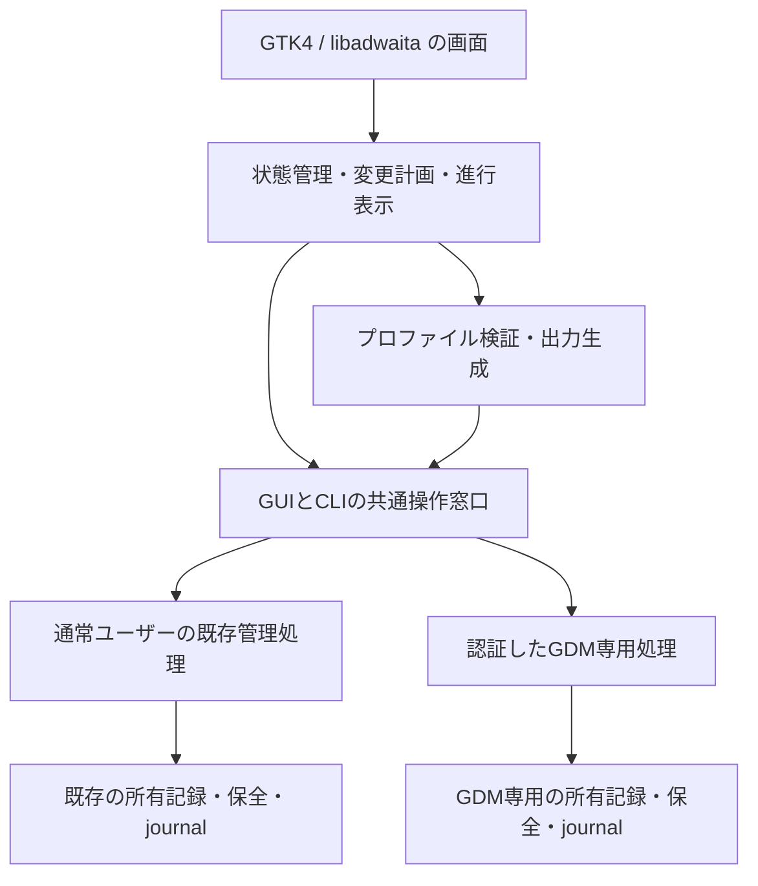

# Hyalune 設定アプリ：基本構成と作成方針

v0.2.0（2026-10-25）。既存CLIを共用する「Hyalune 設定」を追加しました。通常外観・プロファイル・既存ぼかし・選択Flatpakの一括反映と、利用者単位のアプリ導入をVMで検証しています。Flatpakの共通追従・個別値と、GDM専用権限窓口・画像／素材／ユーザー名色編集も実装しました。実GDMでの本人認証・次のログイン画面のレビューは、VMでの利用者確認として残っています。以下は実装済みの入口と、後続工程を含む設計です。

## 現在使える範囲

- 通常は共通の不透明度・素材色とプレビューを表示します。「部分ごとに調整」を開き、対象を選んだときだけ編集欄を表示します。開閉では値を変更しません。
- 対象選択の一覧はDarkで半透明にし、背後の文字と区別できる不透明度80％を使います。文字と選択表示は標準のまま、High Contrastでは標準の不透明表示へ戻します。編集中の候補値とは独立した管理UI用の材質です。
- パネル・Shellの面・GTK3／GTK4の窓を個別に調整できます。共通面56％・パネル38％を再現する既定値です。色入力は追加操作で開きます。
- 編集・保存・最後の配置・実読み込みを区別します。プレビューの候補CSSは専用クラス内だけへ適用します。
- Quick Settingsとウィンドウ効果を独立に選べます。実際に描画するかは既存拡張の対応条件に従います。
- Flatpakを起動時／再検出で調べ、対応する停止中のGTK系を選択します。選択分と通常テーマを既存の同じjournalへ含めます。追従登録したアプリは次回の共通設定適用に自動で含めます。個別設定の素材値は共通値を変えても維持し、「現在の適用を保持」はCSSを更新しません。起動中・競合中・未判定・未導入は理由付きで保留し、適用済みと表示しません。常駐や自動起動は追加しません。
- 「直前の適用へ戻す」は直前のプロファイル更新と選択Flatpakの保存bytesを復元します。変更後の外部編集・起動中アプリ・拡張コード更新は停止します。初回導入を戻す場合は「テーマを解除」を使います。
- 解除は通常テーマと管理Flatpakの一括復元、中断復旧は既存journalを使います。GDMやバックアップを消しません。
- GDM画面では背景画像・不透明度・素材色・ユーザー名色を編集し、通常テーマと別に確認・適用・解除・復旧します。起動や画面選択で管理者認証を出しません。画像のデコードは通常ユーザーで行い、実GDMにはroot管理コピーを使います。警告、パスワード入力、ボタン、選択不可の利用者行、High Contrastの標準表示を保持します。

### アプリを導入する

通常ユーザーで実行します。管理アプリにはPython3 / PyGObject、GTK4、libadwaita、`sassc`が必要です。依存パッケージの自動導入はしません。GTK4 4.22／libadwaita 1.9で検証しています。

```sh
./install.sh manager install   # 初回・更新で共通
./install.sh manager status
```

アプリ一覧・検索から「Hyalune 設定」を開きます。起動中に本体を更新した場合は、編集内容を保存してから閉じて開き直してください。本体は`~/.local/share/hyalune/settings/app/`、入口は`~/.local/share/applications/io.github.NBE03xxx.Hyalune.Settings.desktop`、アイコンも利用者領域に配置します。起動先は導入済み本体で、Gitの取得先や起動時のカレントディレクトリに依存しません。

アプリ本体だけの解除と中断復旧は次です。テーマ、`~/.config/hyalune/profile.json`、既存の保全を残します。テーマ解除はGUIの「履歴と復元」または既存`./install.sh remove`を使います。

```sh
./install.sh manager remove
./install.sh manager recover  # アプリ導入の中断時だけ
```

テーマやFlatpakの反映にはアプリ再起動・再ログインが必要です。自動終了・自動ログアウトはしません。VMでの分離検証から開始した開発版であり、全倍率・アクセシビリティ・実機GUIの網羅確認はまだです。

### Flatpakの追従と個別値

「Flatpakアプリ」で対象の名前を選ぶと、そのアプリだけの設定が開きます。

| 設定方法 | 適用時の動作 |
| --- | --- |
| 共通設定に追従 | 共通外観を適用するたびに、対応するGTK設定を反映 |
| 個別設定 | そのアプリの不透明度・素材色を保持して反映 |
| 現在の適用を保持 | 既存のCSSを維持し、共通外観の適用では変更しない |

詳細を閉じても値は残ります。変更はプレビュー・保存・適用で区別し、閉じるだけで適用しません。再検出で新しいFlatpakを表示し、対象を選んで追従または個別設定へ登録します。登録していないアプリを勝手に取り込みません。保留中の追従アプリは、終了・競合解消後の次の「適用」で追いつきます。

### GDMの編集と権限窓口

管理者が信頼できる取得済みソースから、一度だけ専用処理を導入します。通常ユーザー用のアプリ導入とは別です。導入・更新だけではGDMの外観や背景を変更しません。

```sh
sudo ./install.sh manager-gdm install  # 初回・更新
sudo ./install.sh manager-gdm status
```

「ログイン画面」の「現在のGDM設定を確認」で初めて管理者認証を求めます。編集後の変更確認と適用にも認証が必要です。管理者認証の取消・認可失敗時に変更処理を開始しません。固定したroot所有の処理へ限定したJSONだけを渡し、GUI全体や取得先のPythonをroot起動しません。

背景は保存済みを保持、現在の壁紙、同梱背景、ローカル静止画像から選べます。初回は背景の明示選択が必要です。画像の読取・デコードは通常利用者へ権限を落として行い、最大32MiBの元画像・40百万画素・64MiBの正規化PNGへ制限します。動的XML・アニメーションは停止します。更新時は保存済み背景を保持するのが既定です。

素材色と不透明度、ユーザー名の文字色をプレビューで確認します。文字色指定は利用者一覧と認証フォームのユーザー名へ限定し、警告や入力欄の色は標準を使います。初期値は既存の32％です。実読み込みは次のログイン画面からで、自動ログアウト・GDM再起動は行いません。表示と通常ログインは本人が確認します。

GDMの編集中データは`~/.config/hyalune/gdm.json`へ明示保存できます。保存は実GDMへの適用とは別です。通常テーマの「適用」「解除」「既定値へ戻す」ではGDMを変更しません。

専用窓口の解除も、GDMテーマの解除とは異なります。窓口だけを外してもGDMの所有情報・資源・バックアップは保持し、既存の`./install.sh gdm`で管理・復旧できます。

```sh
sudo ./install.sh manager-gdm remove
sudo ./install.sh manager-gdm recover # 窓口導入の中断時のみ
sudo ./install.sh gdm recover         # GDM反映そのものの中断時
```

polkitは各操作に`auth_admin`を要求し、認可を永続保存する規則や常駐サービスを追加しません。権限窓口は`/usr/local/libexec/hyalune-gdm-settings`、検証済みコードはroot所有の版別配置、導入記録は`/var/lib/hyalune-gdm-helper/`です。既存GDM所有・journalは`/var/lib/hyalune-gdm/`を継続します。旧リリースと導入前の入口を保全し、未知の外部編集は上書きしません。

### プロファイルと操作応答

`src/manager/profile.py`はFlatpakの追従／個別値を含むformat 2と従来のformat 1を読みます。旧版のhashを読み替えて上書きせず、編集時に移行し、起動だけでは保存しません。通常profileの従来`gdm`値は互換用で、実GDMの設定は別のGDM専用データと所有記録で扱います。型付きJSONを検証し、固定したSCSS entryへ変数を渡して`sassc`で生成します。任意CSSやimportを設定として受け付けません。既定値の5出力はv0.1.1とbytes一致します。GTK4では下地を内容面以下の不透明度に抑え、残りを重ねて合成します。下地100％の除算も回避します。文字・アイコン全体のopacityは変えません。

`tools/manage-settings.py`は`api=hyalune.settings`／`version=1`のJSON応答を返します。`ok`、`operation_id`、`result`または`error.code/message`を持ちます。通常テーマ・Flatpakは既存の所有記録へ適用profileのhashを付記し、復元元を置き換えません。管理GUI用の別テーマ台帳は作りません。

`plan`が返すtokenを`set`へ渡し、共有ロック取得後に変更計画が同一か再照合します。解除も同様です。旧固定値は既知の出力hashに一致するときだけ対応付け、異なる旧版・外部変更を推測で現在値として扱いません。GDMの値・反映状態は通常テーマの成功へ含めません。

アプリ本体・入口の所有記録だけは`~/.local/state/hyalune/settings-installer-v1/`へ分離します。外観の共有ロックを使い、アプリ解除でテーマの所有情報を変更しません。

## 目的

不透明度・色・ぼかし・背景画像を、コマンドを覚えずに調整できるようにします。設定の連動と個別調整、後から追加したFlatpakの選択適用、元の状態への復元を一つのアプリで扱います。

初回導入と更新で操作を分けず、画面上は「適用」とします。内部では現在の所有記録から必要な操作を選びます。表示名の案は「Hyalune 設定」です。テーマの既存識別子・配置先・拡張UUIDは維持します。

## 現在の実装との関係

| 項目 | 既存機能 | アプリに向けて必要な追加 |
| --- | --- | --- |
| 通常テーマ | 導入・更新・状態確認・一括解除・中断復旧、既存GTK設定保全 | GUI用の操作窓口、プロファイルからの出力生成 |
| 任意ぼかし | Quick Settings／ウィンドウの有効・無効、条件外での停止 | 状態・停止理由の表示。半径等の編集は後から個別検証 |
| Flatpak | GTK判定・scan・個別適用／解除、初回自動適用、一括解除 | 一覧、複数選択、共通設定の再反映と同じ処理記録への統合 |
| GDM | 独立CLI、現在の壁紙の取り込み、背景保持・入替、解除・復旧 | 専用権限窓口、任意画像選択、素材・文字色の生成と検証 |
| 色・不透明度 | SCSSに固定値を定義 | 保存形式、変換、検証、プレビュー、適用履歴 |

既存の成功した処理を呼び出すだけで、色編集まで完成するわけではありません。導入管理と、設定値からCSSを生成する機能を分けて実装します。

## 技術構成

**Python 3＋PyGObject＋GTK4＋libadwaita**を採用しています。既存のPython管理処理と接続しやすく、GNOME標準の入力・キーボード操作・画面サイズへの対応を使えるためです。開発環境ではGTK 4.22.4／libadwaita 1.9.1の読み込みを確認しました。実装開始時にVM側でも照合し、未確認の新APIを前提にしません。

- GUIは通常ユーザーで起動します。状態取得や時間のかかる適用は非同期で実行します。
- 最終的な標準利用は、通常ユーザー向けにアプリ本体とデスクトップエントリー（`.desktop`）・アイコンを導入し、アプリメニューや検索から起動する形とします。ソースからの直接起動は開発用とし、メニュー起動を完成条件に含めます。CLIも復旧用に残します。
- 初期配布は現在のソース導入に合わせます。管理アプリ自身のFlatpak化・deb化、常駐監視・自動更新は初期版に含めません。
- 管理画面は可読性を優先します。編集中の候補CSSは専用プレビューに限定し、管理画面全体へ流し込みません。
- 初期は日本語を基本に、表示文言と内部の状態コードを分け、翻訳を追加できる構成にします。

参考：[PyGObject公式ガイド](https://pygobject.gnome.org/getting_started.html)、[libadwaitaの画面構成](https://gnome.pages.gitlab.gnome.org/libadwaita/doc/main/adaptive-layouts.html)。これらは技術選定の参考で、対象環境での動作確認の代わりにはしません。

## 画面構成

左側の一覧で画面を選び、右側で設定する構成を第一候補とします。狭い画面では一覧と内容を切り替える表示にします。

| 画面 | 主な内容 |
| --- | --- |
| 概要 | 配置版・反映状況、導入済みの範囲、競合・中断・再ログイン等の案内、適用・更新 |
| 外観 | 共通の不透明度・素材色とプレビューを基本表示。個別調整を選んだ場合だけ対象の設定を表示 |
| ぼかし | Quick Settings・ウィンドウの有効／無効、現在利用できない理由 |
| ログイン画面 | GDMの利用・解除、背景選択・現在の壁紙の取り込み、不透明度・文字色、GDM専用の適用 |
| Flatpakアプリ | Flatpakの再検出、対応状況、選択適用・更新・解除、共通値への追従／個別設定 |
| 履歴と復元 | 適用履歴、変更前へ戻す、中断復旧、導入前の状態へ戻す |

Shell・GTK・拡張・GDM・Flatpakという管理対象を、この画面構成へ整理します。配布の第1〜第4層を増やすものではありません。

「Hyaluneの既定値に戻す」「直前の適用へ戻す」「テーマを解除して導入前へ戻す」を区別します。通常テーマとGDMは別の解除操作とし、対象範囲を操作ボタンの近くに表示します。

## 選択肢を必要なときだけ見せる

通常の外観画面は、プレビュー・共通の不透明度・素材色・「適用」を中心にします。文字色の指定や対象別の詳細など、追加の調整は必要な操作を選んだときに開きます。すべての対象とスライダーを起動直後から並べません。

個別調整の流れは次の案です。

1. 外観画面から「部分ごとに調整」を選びます。
2. パネル・メニュー・特定のアプリ等から、調整する対象を選びます。
3. 選択した対象に必要な項目だけを表示します。他の対象の詳細は閉じたままにします。
4. その対象の設定を使うか、「共通設定に戻す」かを選べるようにします。

「詳細を閉じる」と「共通設定に戻す」は別の操作です。詳細を閉じても設定を消さず、選択しただけで実環境へ反映しません。共通へ戻す操作も、プレビューと未適用の変更へ反映し、最後の「適用」で確定します。

個別設定がすでにある場合は、「個別設定あり」の簡潔な要約を表示し、そこから対象の詳細へ進めます。再起動時に詳細をすべて展開したり、非表示だからと既存の値を解除したりしません。初期値のパネル38％・GDM32％もこの原則で維持します。

- 最初の画面で日常的に使う操作を完結させ、専門用語や内部の層番号を選ばせません。
- 「標準色を使う」間は色指定の入力欄を出さず、「色を指定」を選んだときに表示するなど、各設定でも同じ方針にします。
- 高度な設定を何段も入れ子にせず、対象を選べば設定へ到達できる構成にします。
- 未実装・未対応の選択肢を大量に無効表示しません。必要な対象画面で理由を短く示します。
- 競合・中断・未適用変更・再起動待ちなど、利用者が判断すべき状態は詳細設定の奥へ隠しません。
- タブ・キーボード・スクリーンリーダーでも、詳細を開閉したことと現在の対象が分かるようにします。

## デスクトップエントリーによる導入

完成形では、アプリ本体・デスクトップエントリー・アイコンを利用者単位でインストールします。「Hyalune 設定」をアプリ一覧や検索から起動でき、毎回ターミナルを開いたり、リポジトリのディレクトリへ移動したりする必要がない形にします。

起動先は管理する導入済みアプリ本体とし、開発時の作業場所やカレントディレクトリに依存させません。Gitの取得先を移動した場合でも導入済みアプリが起動できる構成を検討します。アプリ名・アイコン・アプリIDの整合と、更新後も同じ入口で起動できることを確認します。

アプリ本体と入口の導入・更新・解除を同じ管理範囲にします。必要な依存や導入失敗を確認し、起動先のないエントリーだけを残さないようにします。アプリ本体の解除、テーマの適用解除、プロファイルやバックアップの削除は別の意味として扱い、アプリを解除しただけで利用者の外観・保全を消しません。

メニューから起動した場合も通常ユーザーで動作します。GDMの権限処理の配置・認証は別途管理します。自動起動・常駐は追加しません。

## 普段の操作

1. 起動時に通常テーマとFlatpakの状態を読み取ります。初回起動だけで適用・初期化しません。
2. 値を編集し、画面内のプレビューで確認します。スライダーを動かすたびに実環境を書き換えません。
3. 「適用」で対象と変更内容を示し、既存の保全・競合検査を経て反映します。毎回CLI名や初回／更新の違いを選ばせません。
4. 結果として、反映済み・アプリ再起動待ち・再ログイン待ち・保留・失敗を対象別に表示します。

GDMは独立した「ログイン画面に適用」から実行します。通常の外観編集で暗黙に変更しません。画面を開いただけで管理者認証を出さず、初期段階では「詳しい状態を確認」等の明示操作で必要な権限を求めます。現在のGDM status自体がroot専用であることを考慮します。

適用中は対象への再操作を抑止します。書き込み開始後の「キャンセル」を強制終了にせず、処理完了・復旧までの状態を表示します。閉じる操作やプロセス終了でもjournalを失わない設計にします。

## 内部の分担



### 画面と管理処理

画面は任意のCSSファイルや所有記録を直接書き換えません。初期の接続は、既存CLIを固定した引数配列で非同期実行する薄いアダプターを第一候補にします。シェル文字列の組立や、日本語・英語のメッセージ解析での成否判断は避けます。

GUI向けには版付きのJSON応答を整備します。操作ID、対象、配置状態、適用したプロファイル、競合・保留の理由、反映待ち、復旧の可否を定義し、失敗も構造化します。既存CLIの引数と出力は互換性を維持します。必要になった箇所から共通モジュール化し、一度に管理エンジン全体を書き換えません。

変更計画の作成後にCLIや他プロセスが状態を変えた場合は、適用時に再照合します。アプリの単一起動だけに依存せず、既存の共有ロックと所有検査も維持します。

### GDMの権限

GUI全体をrootで起動しません。**管理者所有のGDM専用処理＋polkitによる認証**を実装しました。必要なときだけ起動する窓口とし、常駐を必須にしません。

GDM側が受け付ける操作と設定型を限定し、呼び出したユーザー・画像・生成元・所有状態を再検証します。ユーザーが指定したPython／シェルコード、任意の出力先、任意CSSをそのままroot実行する窓口にはしません。画像の読取・デコードは通常ユーザーの権限で行い、GDM用の管理コピーを使う方針を引き継ぎます。

現在の開発用`pkexec python3 <checkoutのスクリプト>`を、公開GUIの固定した権限設計として流用しません。専用処理の配置・更新・解除と、CLIとの互換もVMで検証する独立工程です。[polkit公式の設計説明](https://www.freedesktop.org/software/polkit/docs/latest/polkit-apps.html)

通常テーマとGDMは別のトランザクションです。「通常テーマは成功、GDMは未適用」のような結果を正しく表示します。共通プロファイルに連動していても、GDMの反映まで自動的に成功したとは表示しません。

## プロファイルとCSS生成

設定値は版付きJSONを第一候補とします。色は検証済みの色値、不透明度は0〜1の数値、追従と個別上書きを明示します。任意のCSSや実行命令は設定形式へ入れません。

- **編集内容**、**保存したプロファイル**、**各対象へ最後に適用した設定**を区別します。保存だけで適用済みにしません。
- 共通の素材色・不透明度を正本とし、Shell・GTK3・GTK4・Flatpak・GDMごとの変換を持ちます。同じ数値の単純コピーではなく、重ね塗りを含めて計算します。
- 例として現在の共通面56％、パネル38％、GDM32％を保持したまま初期化します。GDM等の個別値は「個別設定」と表示し、連動へ切り替えるときに変更を示します。
- GTK4の38％の下地と内容面の重ね合わせを、単独面の56％と混同しません。文字・アイコンを含むActor全体のopacityは操作しません。
- 文字色は標準色を使う選択と指定色を分けます。警告・無効・選択・フォーカス・High Contrastを同じ色で塗りつぶしません。
- ぼかしは既存の2つの有効／無効を先行します。半径・品質等は現在の公開設定に存在しないため、対応する実装・性能検証後に追加します。
- Light切り替えは、Lightテーマの実装ができてから追加します。初期画面へ機能するように見える切り替えを置きません。

プロファイルの保存先候補は`~/.config/hyalune/`です。既存の所有・復元情報は従来の`~/.local/state/glass50/`を継続使用し、別の管理台帳を並行して作りません。GDMは従来のroot専用保存先を維持します。

CSS生成はSCSSを編集元とする設計を維持します。候補は「型を限定した値→一時的な変数ファイル→既存SCSS→対象別の候補CSS→パッケージ／適用」です。通常ユーザーの設定がroot側の任意SCSS importにならないよう分けます。

管理アプリで任意の色・不透明度を生成するため、初期実装は`sassc`を明示依存にしました。通常の固定テーマ導入には追加しません。SCSSソースを同梱し、出力を手修正する方式や広範囲の正規表現置換を管理アプリの基盤にしません。

### 既存導入の引き継ぎ

既存テーマを一度解除することや、バックアップを作り直すことを開始条件にしません。現在の所有記録と復元情報を読み取り、既知の生成物と一致する場合に限って固定値をプロファイルへ対応付けます。

由来を判別できないCSSを推測で現在のプロファイルと表示しません。「旧版の固定値」「外部変更あり」「未判定」を示し、既存の競合停止を尊重します。最初のアプリ起動で既定値を上書きしません。

### Flatpakとの連動

起動時と「再検出」で一覧を更新し、後から入れたアプリを未適用として表示します。対応を確認できたGTK系、起動中、競合、未判定、Qt等の未対応を区別します。

従来の通常CLI updateは管理中Flatpakを更新しません。管理アプリの操作窓口では、選択した対応Flatpakを通常テーマと同じjournalへ統合しました。共通追従・個別値・保持を既存の同じjournalへ統合しました。GDMはこのjournalへ含めません。

### プレビュー

最初は標準部品と明暗・模様の異なる背景を使ったアプリ内プレビューを用意します。GTK部品の実描画と、Shell／GDMの参考表示を区別します。実際のShell・GDMの確認はVMの独立セッションで行います。

画像選択では、従来のデスクトップ壁紙取り込み・同梱背景に加えて、利用者が静止画像を選ぶ入口を追加しました。画像形式・大きさの制限、画像なし・動的背景の扱いは既存の検査を引き継ぎます。

## 作成順序と最初の完成範囲

| 段階 | 作るもの | 完了の判断 |
| --- | --- | --- |
| A：状態確認 | GUIの骨格、通常テーマ・ぼかし・Flatpakの状態、明示したGDM確認入口、既存CLIへのアダプター、メニュー導入の土台 | 初期表示に個別設定を並べず、起動だけで設定を書かず、配置と読み込みを区別し、競合・中断・対応外を正しく表示 |
| B：最初の実用版 | 共通プロファイル、Shell／GTKの不透明度・素材色、選択時だけ開く個別調整、既存ぼかしの切替、プレビュー・適用・解除・復旧、デスクトップエントリー導入 | 初期値で現状を再現し、VMで変更→再読込→戻すを確認、既存導入の復元情報を保持。アプリメニューからの起動・更新・入口解除も確認 |
| C：Flatpakアプリ | Flatpak一覧・複数選択・共通値追従、後追加検出、管理中アプリへの一括再反映 | 起動中・競合・未対応を正しく保留し、中断時に通常テーマと整合して戻る |
| D：GDM編集 | 専用権限窓口、画像選択、不透明度・文字色、独立した適用と復元 | 認証取消・中断・再ログイン待ちを扱い、VMで表示・本人認証・解除復旧を確認 |

GDMの画面枠と既存状態への入口はAで用意し、素材・画像編集までをDで仕上げます。最初から全対象の編集を同時に完成させる計画にはしません。文字色の通常テーマ側編集も、各状態の可読性を確認しながらB以降で広げます。

開発は既存Ubuntu VMの専用設定・独立セッションから進めます。各段階で現行外観の再現、通常操作、解除・復旧を確認してから通常VM、実機へ広げます。T16の確認済み外観と過去のバックアップは設計整理の段階で変更しません。

初期版で扱わないものは、常駐監視、アプリの自動起動・強制終了、パッケージ／ドライバー操作、PAM・認証方式変更、Qt・Snap・AppImageのテーマ保証、Lightの実装です。

## 次の作業

A〜Dの機能をVMで段階実装し、Flatpak追従／個別値・GDM専用権限窓口と画像・素材・ユーザー名色まで検証しました。次は実際のpolkit認証を伴う本人のGUI操作と、必要な場合の次のログイン画面の表示・通常ログインの確認です。全倍率・支援技術・長時間の確認は別に残ります。T16への導入・新しい公開操作は今回のVM検証から自動実行しません。
